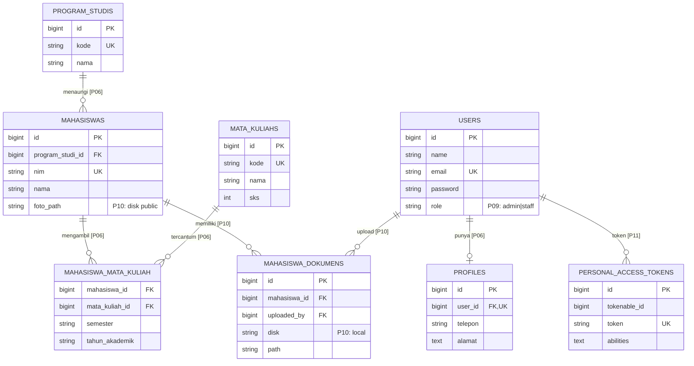

# ERD Proyek Praktikum `laravel-si`

Data sengaja sederhana untuk pembelajaran relasi. Prefix `Pxx` adalah pertemuan ketika konsep tersebut menjadi fokus.

**PK** = primary key. **FK** = foreign key. **UK** = unique index.

- **P04:** tiga tabel akademik dibuat dengan migration dan constraint.
- **P06:** `profiles.user_id` unik -> one-to-one; `mahasiswas.program_studi_id` -> one-to-many; pivot `mahasiswa_mata_kuliah` -> many-to-many.
- **P09:** users memiliki role admin/staff.
- **P10:** file disimpan di filesystem, **hanya metadata/path** berada di database. `foto_path` menunjuk disk publik sedangkan `mahasiswa_dokumens.path` disk privat.
- **P11:** Sanctum menyimpan **hash** token + abilities, tidak menyimpan token mentah.
- **P12:** JSONPlaceholder **tidak memerlukan tabel**, karena data hanya diambil secara dinamis melalui HTTP Client.
